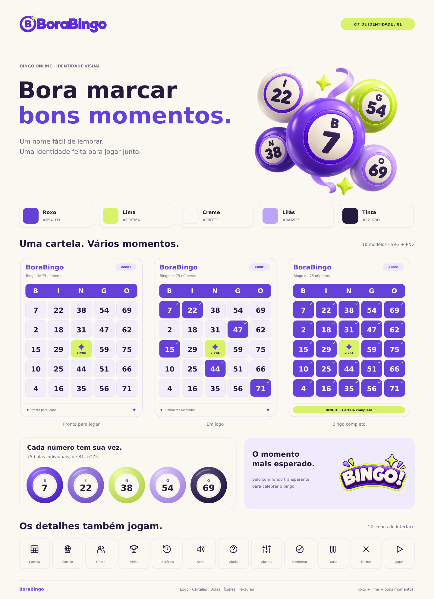
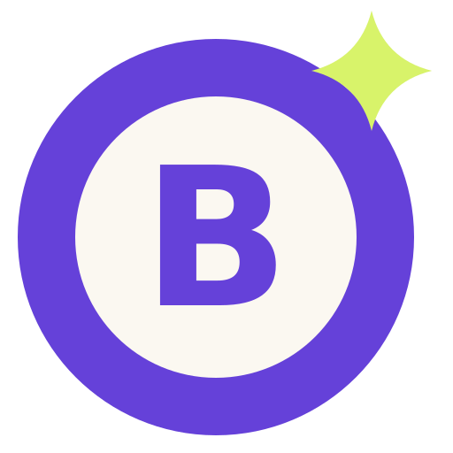

<p align="center">
  
</p>

<p align="center">
  
</p>

<p align="center">
  <strong>Ecossistema de Microsserviços · Bingo Online Concorrente</strong><br/>
  Spring Boot 3 · MongoDB ReplicaSet · RabbitMQ · JWT Cookie · React Native Web
</p>

<p align="center">
  
  
  
  
  
  
</p>

---

## 🎨 Identidade Visual

<p align="center">
  
</p>

---

## 🏛️ Arquitetura dos Microsserviços

| Microsserviço | Porta | Responsabilidade |
| :--- | :---: | :--- |
| **API Gateway** (`gateway-service`) | `8080` | Roteamento, CORS, validação JWT via Cookies HttpOnly, RBAC (`ROLE_ADMIN` vs `ROLE_USER`). |
| **Auth Service** (`auth-service`) | `8081` | Usuários, BCrypt, JWT em cookies `HttpOnly SameSite=Lax`, débito e crédito de saldo. |
| **Bingo Sala Service** (`bingo-sala-service`) | `8082` | Salas, sorteio de números (1-75), controle de vagas, publicação de eventos RabbitMQ. |
| **Cartela Service** (`cartela-service`) | `8083` | Compra assíncrona via fila, Consumer ACK/NACK manual, DLQ, geração de matriz 5×5, validação de vitória e prêmio. |

---

## 1. 🍪 Cookies e Autenticação

- O Token JWT é gravado **exclusivamente nos Cookies** do navegador (`Application > Cookies > bingo_auth_token`):
  - `HttpOnly = true` — impede acesso via JavaScript (proteção contra XSS).
  - `SameSite = Lax` — proteção contra CSRF.
  - `Secure = false` — desenvolvimento local (`true` em produção HTTPS).
  - `MaxAge = 86400` — expira em 24 horas.
- O Frontend **não armazena nada em localStorage**.
- O Gateway lê o cookie, valida a assinatura HMAC-SHA256 e injeta `X-Auth-Username`, `X-Auth-Role` e `X-Auth-UserId` nos headers internos para os microsserviços downstream.

---

## 2. 🗄️ Transações com MongoDB (`@Transactional`)

- MongoDB configurado em **Replica Set** (`rs0`) — pré-requisito para transações ACID multi-documento.
- Bean `MongoTransactionManager` declarado em cada microsserviço.
- Métodos críticos usam `@Transactional`: em caso de falha (saldo insuficiente, vaga esgotada, erro interno), o MongoDB desfaz todas as escritas automaticamente — sem cartelas órfãs ou estados inconsistentes.

---

## 3. 🐇 Mensageria, Filas e Pub/Sub (RabbitMQ)

### Fluxo de Compra Assíncrona

```
POST /comprar → salva PENDENTE → Publish RabbitMQ → 202 ACCEPTED
                                        ↓
                              CompraCartelaConsumer (ackMode=MANUAL)
                                        ↓
                         processarCompraFila() @Transactional
                         ├─ valida sala + vagas
                         ├─ debita saldo (auth-service)
                         ├─ incrementa contador (sala-service)
                         ├─ gera matriz 5×5
                         ├─ CONFIRMADO → basicAck
                         └─ REJEITADO  → basicNack → Dead Letter Queue
```

### Eventos de Sala (Pub/Sub)

| Evento | Routing Key | Fila |
|:---|:---|:---|
| `SALA_CRIADA` | `bingo.sala.criada` | `bingo.sala.eventos.queue` |
| `SALA_INICIADA` | `bingo.sala.iniciada` | `bingo.sala.eventos.queue` |
| `NUMERO_SORTEADO` | `bingo.numero.sorteado` | `bingo.sorteio.eventos.queue` |
| `BINGO_FINALIZADO` | `bingo.sala.finalizada` | `bingo.sala.eventos.queue` |
| `COMPRA_SOLICITADA` | `bingo.cartela.compra.solicitada` | `bingo.compra.cartela.queue` |

---

## 4. 🔄 Ciclo de Vida das Cartelas

| Status | Quando | Método |
|:---|:---|:---|
| `PENDENTE` | Solicitação recebida — antes da fila | `solicitarCompraCartela()` |
| `PROCESSANDO` | Consumer iniciou validações | `processarCompraFila()` |
| `CONFIRMADO` | Saldo debitado, matriz 5×5 gerada | `processarCompraFila()` |
| `REJEITADO` | Sem vaga, saldo insuficiente ou erro | `rejeitarCartela()` |

---

## 5. ⚡ Testes de Carga e Concorrência com K6

<p align="center">
  
</p>

O script [`k6-test-concorrencia.js`](k6-test-concorrencia.js) simula **30 jogadores simultâneos** disputando **20 vagas** na mesma sala:

```bash
# Execução padrão
k6 run k6-test-concorrencia.js

# Parâmetros customizados
k6 run -e MAX_CARTELAS=10 -e QTD_REQUISICOES=25 k6-test-concorrencia.js
```

**Resultados esperados:**

| Métrica | Valor |
|:---|:---|
| `bingo_cartelas_confirmadas` | Exatamente **20** |
| `bingo_cartelas_rejeitadas` | Exatamente **10** |
| `bingo_timeout_polling` | **0** |
| `cartelasVendidas` no banco | **≤ maxCartelas** (sem overbooking) |

---

## 6. 🛡️ Controle de Acesso (RBAC)

| Perfil | Permissões |
|:---|:---|
| `ROLE_USER` | Visualizar salas, comprar cartelas, marcar números, bater bingo |
| `ROLE_ADMIN` | Criar salas, iniciar partidas, sortear números + tudo do usuário |

A proteção é feita no **backend** — o `AuthenticationGlobalFilter` do Gateway bloqueia requisições para `/api/salas/admin/**` sem `ROLE_ADMIN` com HTTP `403 FORBIDDEN`, independente do frontend.

---

## 💰 Sistema de Saldo

- Cada usuário começa com **R$ 100,00**.
- Ao comprar uma cartela o preço é **debitado** automaticamente após confirmação.
- Ao vencer o Bingo o prêmio (`cartelasVendidas × precoCartela`) é **creditado** instantaneamente.
- O saldo é exibido no header e atualiza em tempo real (polling de 3s).

---

## 🚀 Como Executar

### 1. Infraestrutura (MongoDB + RabbitMQ)
```bash
docker-compose up -d
```

### 2. Microsserviços Spring Boot
```bash
# Em terminais separados:
cd gateway-service    && ./mvnw spring-boot:run
cd auth-service       && ./mvnw spring-boot:run
cd bingo-sala-service && ./mvnw spring-boot:run
cd cartela-service    && ./mvnw spring-boot:run
```

### 3. Frontend Web
```bash
cd frontend && npm install && npm run web
# Acesse: http://localhost:3000
```

### 4. Credenciais de teste

| Perfil | Username | Senha |
|:---|:---|:---|
| Jogador | `jogador` | `jogador123` |
| Administrador | `admin` | `admin123` |

---

<p align="center">
  
  <br/>
  <sub>FATEC · Projeto de Microsserviços</sub>
</p>
